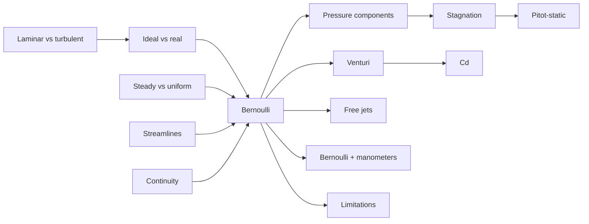

# Elementary Fluid Dynamics

Part II of [[Block 2 MOC]] · **Exam Q3 (20 marks)** · Lectures 6–9

> [!summary] The model
> Fluid in **motion**, driven by applied pressure, analysed with Newton's 2nd law. We assume an **ideal** fluid: inviscid, incompressible, laminar, steady.

## The chain of ideas

### 1 · Characterising flow
- [[Ideal vs Real Fluids]] — inviscid vs viscous, no-slip
- [[Laminar vs Turbulent Flow]] — Reynolds number
- [[Steady vs Uniform Flow]] — time vs space
- [[Streamlines]] — and streamtubes
- [[Continuity Equation]] — $A_1V_1 = A_2V_2$

### 2 · The Bernoulli equation
- [[Bernoulli Equation]] ← the main result, its forms and its constant
- Derivations: [[Bernoulli Derivation - Energy]] · [[Bernoulli Derivation - Streamtube]]
- Meaning of the terms: [[Pressure Components in Flow]] → [[Stagnation Pressure]]
- [[Bernoulli Limitations]]

### 3 · Applications
- Velocity: [[Pitot-Static Tube]]
- Flow rate: [[Venturi Meter]] + [[Discharge Coefficient]]
- Tanks and nozzles: [[Free Jets]]
- Coupled with statics: [[Bernoulli with Manometers]]

## Practice
See the dynamics section of [[Worked Examples Index]].
