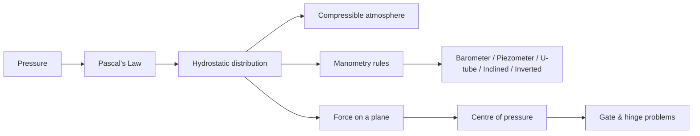

# Fluid Statics

Part I of [[Block 2 MOC]] · **Exam Q2 (20 marks)** · Lectures 1–5

> [!summary] The assumptions
> Fluid at rest, or moving with **no relative motion** between neighbouring elements → **no shear stress** → the only surface force is [[Pressure]].

## The chain of ideas

### 1 · Pressure at a point
- [[Pressure]] — scalar, compressive, $\mathbf F = -\int p\,\hat{\mathbf n}\,dA$
- [[Pascal's Law]] — the same in every direction (wedge derivation)
- [[Absolute and Gauge Pressure]] · [[Pressure Head]]

### 2 · How pressure varies
- [[Hydrostatic Pressure Distribution]] — $dp/dz = -\gamma$, $p = p_0 + \gamma h$
- [[Compressible Atmosphere]] — isothermal and standard troposphere

### 3 · Measuring pressure
- [[Manometry Rules]] ← the method
- [[Barometer]] → [[Piezometer]] → [[U-Tube Manometer]] → [[Inclined Manometer]] / [[Inverted Manometer]]

### 4 · Forces on submerged planes
- [[Hydrostatic Force on a Plane Surface]] — $F_R = \gamma h_c A$
- [[Centroids and Second Moments of Area]] — reference table
- [[Centre of Pressure]] — $h_{cop} = h_c + I_{xc}/(A h_c)$
- [[Inclined Surfaces]] · [[Pressurised Tanks]]
- [[Gate and Hinge Problems]] ← typical exam structure

## Practice
See the statics section of [[Worked Examples Index]].

> [!quote] Lecturer's summary
> [[ENG2085 Note 6 - Flow Characteristics.pdf#page=2|Note 6 p.2–4]]: a one-page recap of all of fluid statics.
